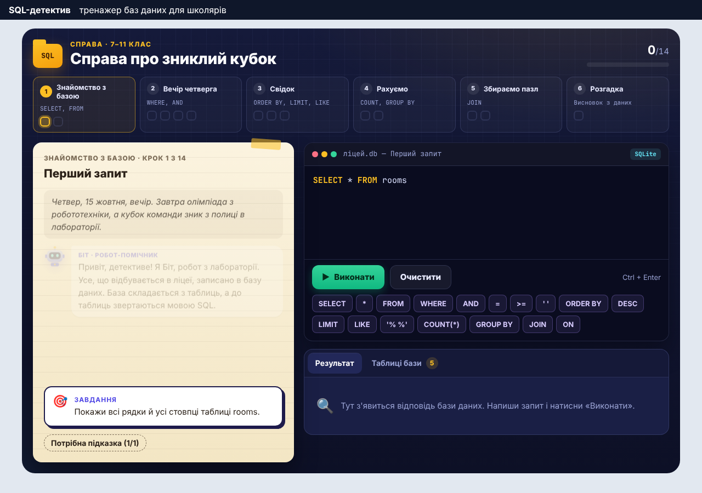

<h1 align="center">edu-sql</h1>

<p align="center">
  <b>SQL detective: an embeddable SQL and database trainer for school students.</b><br>
  A story case, a real SQLite database in the browser, and automatic checks of every query.
</p>

<p align="center">
  <a href="https://zavada123.github.io/edu-sql/"><b>Live demo</b></a> ·
  <a href="#installation">Installation</a> ·
  <a href="#usage">Usage</a> ·
  <a href="#writing-a-case">Writing a case</a>
</p>

<p align="center">
  
</p>

## Why

Children learn SQL faster when every query answers a question they care about. In `edu-sql` the student is a detective: the robotics cup is gone from the school lab the day before the olympiad, and the school database (door card log, canteen, forum posts) holds the answer. Each step teaches one SQL idea and gives a new clue for the detective notebook.

The student-facing interface is in Ukrainian. It was built for [EduProstir](https://eduprostir.com), a Ukrainian learning platform.

## Features

- **Real SQLite in the browser** through [sql.js](https://sql.js.org) (WASM). No server is needed.
- **Every query runs on a fresh copy** of the database, so `DELETE` or `DROP` cannot break the case.
- **Checks by result, not by text:** the student's table is compared with the result of a reference query. Column names and (when the task does not ask for `ORDER BY`) the row order are ignored, so any correct query is accepted. A step can require words such as `JOIN` or `GROUP BY`.
- **Precise feedback in Ukrainian:** "5 columns, but 3 are needed", "too many rows, add a condition", "the rows are correct, but the order is different", and explanations of SQLite errors (`no such column`, `syntax error`, unclosed quotes, aggregates in `WHERE`, …).
- **Story steps:** the robot Біт explains each new idea; answer steps ask the student to draw a conclusion from the data (a number or a name).
- **Hints** from gentle to almost the answer. Each hint lowers the score of the step a little.
- **Phone friendly:** one-tap SQL word buttons, and a tap on a table or column name in the schema inserts it into the query.
- **Protection from runaway queries:** a query that returns more than 5000 rows (for example, a join without `ON`) stops with a message.

Case 1, «Справа про зниклий кубок», covers `SELECT`, `WHERE`, `AND`, `ORDER BY`, `LIMIT`, `LIKE`, `COUNT`, `GROUP BY`, `BETWEEN` and `JOIN` in 14 tasks and 6 lessons (grades 7–11).

Case 2, «Справа про фальшиве голосування», is for grades 9–11. It covers `DISTINCT`, `MIN`/`MAX`, `substr`, `HAVING`, `LEFT JOIN`, `IS NULL`, `JOIN` of three tables and subqueries in 17 tasks and 7 lessons. Its database of about 1 300 rows comes from `scripts/fake-votes-db.py`, a seeded generator that also prints the facts of the story.

## Installation

The package ships as TypeScript source and is compiled by your app's bundler (Vite). Install it from GitHub and pin a commit:

```bash
npm install github:zavada123/edu-sql#<commit>
```

Peer dependencies: `react` and `react-dom` 19 or newer. The bundler must support `?url` imports (Vite does): the SQLite WASM file is served as an asset.

## Usage

```tsx
import { SqlDetective, lostCup } from "edu-sql"

<SqlDetective
  case={lostCup}
  initialProgress={saved}
  onChange={(progress) => saveDraft(progress)}
  onStepSolved={(report) => report.finished && saveGrade(report)}
/>
```

Render the component only in the browser: it loads SQLite in an effect.

`onStepSolved` receives a `Report`:

```json
{
  "caseId": "lost-cup",
  "stepId": "culprit",
  "solvedSteps": 14,
  "totalSteps": 14,
  "finished": true,
  "score": 0.94,
  "progress": { "caseId": "lost-cup", "solved": ["rooms", "…"], "answers": { "rooms": "SELECT * FROM rooms" }, "drafts": {}, "hintsUsed": { "forum": 1 } }
}
```

### Core without React

`edu-sql/core` has the cases and the checker without the UI, for tests or a server re-check. It is compiled to JavaScript in `lib/core` (run `npm run build:lib` after a change in `src/core`), so Node loads it without a bundler:

```ts
import initSqlJs from "sql.js"
import { Sandbox, checkCase, checkQuery, lostCup, allSteps } from "edu-sql/core"

const sandbox = new Sandbox(await initSqlJs(), lostCup.setup)
const step = allSteps(lostCup)[0]
checkQuery(sandbox, step, "SELECT * FROM rooms") // { kind: "ok" }

// Before a certificate: run every saved answer of the student again.
checkCase(sandbox, lostCup, progress.answers) // [{ stepId: "rooms", passed: true }, …]
```

`progress.answers` keeps the accepted query or answer of each solved step. `endExtra` puts your own content (for example a certificate form) on the final screen.

## Writing a case

A `Case` has the SQL that creates the database (`setup`), a description of the tables for the schema panel, the SQL words for the buttons under the editor (`chips`), chapters of steps and an ending. A `query` step has a reference `solution`; an `answer` step has a list of `accepted` answers. The test in `src/core/cases/lost-cup.test.ts` runs every reference solution and checks that the facts in the clues are true. Copy it for a new case.

## Development

```bash
npm install
npm run dev        # demo on http://localhost:5173
npm test           # unit tests
npm run build      # typecheck and build the demo
```

The demo saves progress in `localStorage`. With `?embed=1` it hides its header and sends `{ type: "edu-sql:report", report }` to the parent window.

## License

MIT. The story, characters and drawings are original.
